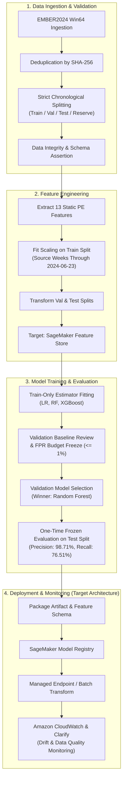
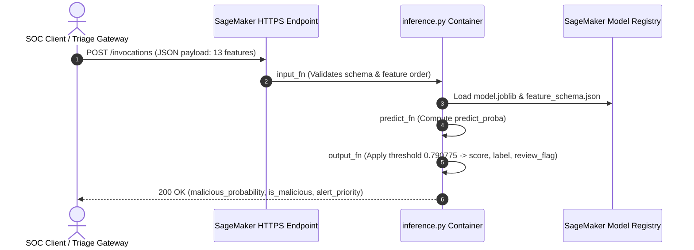

# ML System Design Document: Adaptive Static Malware Detection for Emerging Threats

**Course:** AAI-540 — Machine Learning Operations (MLOps)
**Institution:** University of San Diego
**Team:** Group 1 — Gaurav SS, Marco Gonzalez Ortiz, Nitendra Tiwari
**Document Status:** Final Submission-Ready Technical Design Document
**Repository:** [AAI-540-Final-Team-Project-Group1](https://github.com/dodo0-0/AAI-540-Final-Team-Project-Group1)

---

## Document Status and Scope

This document consolidates the project's architecture, data engineering, feature pipeline, exploratory and candidate modeling results, operational deployment designs, and known limitations. In accordance with professional MLOps practices and course standards, this document explicitly distinguishes verified local evidence from planned or target cloud infrastructure.

| Dimension | Evidenced Status | Target / Proposed Operational Architecture |
|---|---|---|
| **Problem & Use Case** | Binary static PE detection (`0` = benign, `1` = malicious) | Real-time security operations triage queue integration |
| **Data Provenance** | Reconstructed temporal splits (`ember2024_reconstructed_v1`) | Full streaming ingestion pipeline from raw EMBER2024 JSONL |
| **Feature Engineering** | 13 compact PE structural & content-summary features | SageMaker Feature Store with online/offline synchronization |
| **Modeling & Evaluation** | Local candidate comparison (RF winner) & SageMaker baseline LR job | Managed Amazon SageMaker distributed training & HPO jobs |
| **Threshold & Policy** | Frozen validation threshold (0.790775) targeting $\le$ 1% validation FPR | Automated policy-signing and governance gates |
| **Model Registry & Endpoints**| Local artifact serialization (`joblib`, reports, JSON schemas) | SageMaker Model Registry, real-time endpoints & batch transform |
| **Monitoring & CI/CD** | 25 unit tests passed locally; notebook AST validation passed | SageMaker Model/Data Monitor, CloudWatch dashboards, GitHub Actions DAG |
| **Cloud Execution** | SageMaker baseline completed; guarded notebooks default `RUN_AWS = False` | IAM least-privilege, encrypted private S3 buckets, VPC endpoints |

---

## Executive Summary

Malware authors continually adapt executable structures, packing mechanisms, and metadata to evade traditional signature-based detection. This project designs, evaluates, and documents an MLOps-compliant static malware detection system leveraging the Windows 64-bit (Win64) partition of the EMBER2024 benchmark. By restricting analysis to static metadata and content-summary features, the system avoids the severe computational overhead, execution delays, and sandbox evasion risks associated with dynamic detonation environments.

The repository includes exploratory data analysis (`01_ember2024_eda.ipynb`), a verified local exploratory modeling workflow (`02_sagemaker_training_evaluation_local_exploratory_label_fix.ipynb`), a guarded SageMaker production template (`02_sagemaker_training_evaluation.ipynb`), automated unit tests, and comprehensive operational documentation. Two distinct sets of exploratory experimental evaluations were conducted:
1. **Local Candidate Comparison (Notebook Random Forest):** Evaluated on a deterministic 100,000-record training sample from the reconstructed data. Random Forest achieved top validation PR-AUC (0.9912 vs. 0.9494 for Logistic Regression and 0.9891 for XGBoost). Under a validation-selected threshold (0.790775) enforcing a strict $\le 1.0\%$ validation false-positive rate budget, the held-out temporal test evaluation demonstrated **98.71% precision** and **76.51% recall** (F1-score: 86.21%, ROC-AUC: 0.9875, PR-AUC: 0.9879).
2. **Managed SageMaker Baseline (Logistic Regression):** A separate baseline training job completed on Amazon SageMaker under an explicit exploratory legacy-preprocessing configuration, achieving validation ROC-AUC of 0.9450, PR-AUC of 0.9442, recall of 89.02%, precision of 87.06%, and FPR of 13.23% at threshold 0.5.

Because original raw JSONL files were unavailable in the local workspace, these results were evaluated against preprocessed reconstructed dataset approximations. All findings are reported with full academic and engineering honesty as exploratory demonstrations of the MLOps workflow, rather than claims of an exact raw-data regeneration or a fully verified production benchmark.

---

## 1. Problem Statement and Intended Impact

### 1.1 Problem Statement
Modern enterprise Security Operations Centers (SOCs) and Managed Security Service Providers (MSSPs) encounter tens of thousands of newly compiled Windows binaries daily. Traditional signature-based detection mechanisms (e.g., file hash matching, static YARA rules) are fundamentally brittle: minor source recompilation, register renaming, or section reordering produces unique cryptographic hashes that bypass signature databases. Conversely, full dynamic sandbox analysis—executing files in isolated virtual machines—requires substantial compute resources, takes 3 to 15 minutes per executable, and is vulnerable to environment-aware evasion (e.g., sandbox detection sleeps).

To address this challenge, our system implements a **machine-learning-based static triage classifier**. By parsing Portable Executable (PE) header metadata, section properties, imported library footprints, and byte/string entropy summaries, the model generates an immediate maliciousness score and classification decision in milliseconds, filtering high-confidence files and prioritizing suspicious samples for deeper human analyst investigation.

### 1.2 Intended Impact Measures
The system's operational impact is measured across five complementary dimensions directly aligned with security and business objectives:

| Objective | Operational Measure | Target / Baseline | Business & Security Rationale |
|---|---|---|---|
| **Malware Interception** | Recall (True Positive Rate) | $\ge 75\%$ at fixed FPR | Maximizes detection of novel and evolving malware before execution. |
| **SOC Alert Hygiene** | Benign False-Positive Rate (FPR) | $\le 1.0\%$ on validation | Every false positive consumes 15–30 minutes of analyst investigation time. |
| **Detection Quality** | Precision & PR-AUC | Precision $\ge 95\%$, PR-AUC $\ge 0.95$ | High precision prevents alert fatigue and ensures automated alerts are actionable. |
| **Throughput & Speed** | Single-record CPU inference latency | $\le 20\text{ ms}$ (p95) | Enables rapid inline triage during file download or email attachment inspection. |
| **Drift Resilience** | Temporal performance degradation | Weekly recall drop $\le 5\%$ | Assesses model robustness as threat actors alter packaging and compiler tooling over time. |

---

## 2. Solution Overview and Architecture

The end-to-end system architecture spans five logical layers: Data Ingestion & Validation, Feature Engineering, Model Training & Selection, Deployment & Inference, and Continuous Governance.



### Layer Responsibility Matrix

| Layer | Implemented Evidence | Target / Planned Production Infrastructure |
|---|---|---|
| **Data & Validation** | Processed CSV splits, SHA-256 deduplication logic, split manifest, EDA notebook. | Streaming S3 ingestion pipeline, automated quarantine for corrupted PE headers. |
| **Feature Engineering** | 13 numerical PE features, replacement scaling parameters (`feature_schema_reconstructed.json`). | Amazon SageMaker Feature Store with online low-latency key-value store and offline S3 sync. |
| **Model Development** | Scikit-learn Random Forest, Logistic Regression, XGBoost; validation-only threshold tuning. | Amazon SageMaker training jobs (`ml.m5.xlarge`), hyperparameter optimization tuning. |
| **Model Registry** | Versioned joblib bundles, JSON evaluation reports, and reproducibility metadata. | Amazon SageMaker Model Registry with approved/rejected governance lifecycle states. |
| **Inference & Serving** | Schema-verified scoring script (`sagemaker_src/inference.py`), local batch scoring. | Real-time SageMaker HTTPS endpoint with auto-scaling, shadow deployment, and batch transform. |
| **Monitoring & CI/CD** | 25 local unit tests, AST notebook validator, local reports directory. | SageMaker Model Monitor (data drift, concept drift), CloudWatch alarms, GitHub Actions DAG. |

---

## 3. Data Sources and Provenance

### 3.1 Raw Dataset Context
The project models the Windows 64-bit (Win64) static subset of the EMBER2024 benchmark. The full EMBER2024 dataset contains weekly JSONL files spanning from September 2023 through December 2024. In the raw dataset, each record contains file-level metadata, PE structural summaries, raw bytes entropy, imported libraries, section properties, and binary labels (`0` = benign, `1` = malicious).

### 3.2 Temporal Partitioning Strategy
To maintain chronological separation and realistically simulate future malware detection, the dataset is partitioned chronologically across 64 collection weeks:

| Partition | Source Weeks | Row Count | Class Balance | Operational Role |
|---|---|---|---|---|
| **Training** | 2023-09-24 through 2024-06-23 (40 weeks) | 400,000 | 200,000 Benign / 200,000 Malicious | Feature transformation fitting and model parameter training. |
| **Validation** | 2024-06-30 through 2024-09-15 (12 weeks) | 120,000 | 60,000 Benign / 60,000 Malicious | Model comparison, hyperparameter selection, and threshold tuning. |
| **Test** | 2024-09-22 through 2024-10-27 (6 weeks) | 59,995 | 29,995 Benign / 30,000 Malicious | One-time post-selection evaluation on unseen newer binaries. |
| **Reserved Production** | 2024-11-03 through 2024-12-08 (6 weeks) | 59,998 | 29,998 Benign / 30,000 Malicious | Untouched holdout; not evaluated or claimed as completed production validation. |

### 3.3 Data Provenance Caveats & Reconstructed Data Integrity
1. **Absence of Local Raw JSONL:** Systematic inspection of local and parent directories confirmed that raw JSONL files were not stored in the local workspace for this finalization.
2. **Reconstruction Methodology:** The available processed splits (`data/processed/ember2024_reconstructed_v1`) are reconstructed approximations derived by reversing previously stored standardization transformations and fitting replacement scaling moments on the reconstructed training split.
3. **Missingness Proxy Limitation:** Because original missing-value indicators were lost during initial normalization, a shared zero pattern across `section_count`, `authenticode_num_certs`, and `authenticode_self_signed` served as an imputation proxy. Genuine zero values may thus be misclassified.
4. **Preprocessing and Temporal-Split Limitations:** The reconstruction script fits replacement scaling moments on the supplied training split but does not independently enforce a per-row source-week cutoff. The verified training split contains source weeks through June 23, 2024 (2023-09-24 through 2024-06-23). Neither validation, test, nor reserved-production splits were used to fit replacement scaling moments.
5. **Academic & Production Scope:** Due to these reconstruction and missingness limitations, exact reproducibility of the original preprocessing pipeline cannot be claimed. Model metrics reflect exploratory results from the respective experiments and demonstrate the MLOps workflow rather than an exact raw-data regeneration or a production-certified deployment.

---

## 4. Data Engineering and Quality Controls

### 4.1 Upstream Pipeline Safeguards
The project data engineering framework (`src/malware_data/`) implements multiple automated validation checks:
- **Deduplication:** Raw copies of EMBER2024 frequently contain identical binaries collected across multiple weeks. All pipelines enforce strict deduplication on the cryptographic SHA-256 hash.
- **Strict Chronological Isolation:** Binaries are assigned strictly by their collection timestamp window. There is zero random reshuffling between time periods.
- **Header & Schema Verification:** Ingestion scripts verify required columns, data types, finite value bounds, and absence of target/lineage columns in the feature matrix.

### 4.2 Quality Assurance Evidence
The repository contains 25 automated unit tests (`tests/`) covering data loading, chronological isolation, schema fingerprinting, and feature transformation rules. In the recorded baseline validation run:
- **Unit Tests:** 25 of 25 passed in 10.69 seconds (`Ran 25 tests in 10.693s, OK`).
- **Notebook Structure Checks:** `scripts/validate_notebooks.py` validated all code cells across all committed notebooks without AST errors.

---

## 5. Feature Engineering

### 5.1 Approved Feature Contract
The model consumes 13 numerical PE features recorded in `feature_schema_reconstructed.json`:

| Feature Name | Type | Description | Security Significance |
|---|---|---|---|
| `general_size` | Float (log-scale) | Total binary file size in bytes | Disproportionately large or tiny files correlate with droppers or packers. |
| `general_entropy` | Float | Byte-level Shannon entropy (0 to 8) | High entropy ($> 7.2$) strongly indicates encryption or binary packing. |
| `strings_numstrings` | Float (log-scale) | Number of extracted ASCII/Unicode strings | Packed binaries typically exhibit few readable strings. |
| `strings_avlength` | Float | Average length of extracted strings | Aberrant string length distributions signal obfuscation routines. |
| `strings_printables` | Float (log-scale) | Total count of printable characters | Measures overall human-readable code density. |
| `strings_entropy` | Float | Entropy of the string character distribution | Highlights obfuscated string tables and encrypted payloads. |
| `section_count` | Float | Number of executable sections (.text, .data, etc.) | High section counts or unusual names indicate custom packing. |
| `import_library_count`| Float | Number of imported DLL modules | Few imports (e.g., only `kernel32.dll`) suggest dynamic API resolution. |
| `export_count` | Float | Number of exported symbols/functions | Distinguishes DLL malware from standard user applications. |
| `richheader_count` | Float | Visual Studio Rich Header compiler tool entries | Identifies compiler toolchain signatures; missing/corrupt in forged tools. |
| `pefilewarning_count`| Float | Parser warnings emitted during PE traversal | Anomalous structural headers frequently generate parser errors. |
| `authenticode_num_certs`| Float | Count of embedded digital certificates | Measures presence of software publisher authentication. |
| `authenticode_self_signed`| Float (binary/count)| Indicator of self-signed certificate status | Self-signed certificates frequently correlate with untrusted or rogue binaries. |

### 5.2 Transformation Pipeline
1. Count-like distributions with heavy positive skew are normalized via $\log(1 + x)$.
2. Continuous features are standardized: $z = (x - \mu_{\text{train}}) / \sigma_{\text{train}}$.
3. Replacement scaling statistics ($\mu, \sigma$) are fitted on the reconstructed training split (covering source weeks 2023-09-24 through 2024-06-23) without an independent per-row cutoff filter. Neither validation, test, nor reserved-production splits were used to fit replacement scaling moments.
4. Missing standardized values are imputed with 0.0 (the fitted training mean).

### 5.3 Target Feature Store Architecture
In production, feature definitions will be managed via **Amazon SageMaker Feature Store**:
- **Feature Group:** `win64-pe-static-features-v1`, keyed on `sha256` with event time `collection_timestamp`.
- **Online Store:** Low-latency DynamoDB-backed store for sub-10ms single-record lookups during real-time endpoint scoring.
- **Offline Store:** S3 Parquet-backed data lake with automatic partition synchronization for historical retraining and drift analysis.

---

## 6. Model Training and Evaluation

### 6.1 Training Methodology and Candidate Comparison
Candidate models were evaluated using a deterministic, stratified 100,000-record training sample (50,000 benign, 50,000 malicious; random seed 42) to balance computational efficiency with representative gradient coverage. Evaluation was performed on the complete 120,000-record validation partition.

Three candidate model families were evaluated:
1. **Logistic Regression (Baseline):** L2-regularized linear model with balanced class weights, serving as an interpretable benchmark.
2. **Random Forest:** Bagged ensemble of 160 trees (max depth 18, min samples leaf 2, balanced subsample weighting).
3. **XGBoost:** Gradient-boosted decision trees (220 estimators, max depth 6, learning rate 0.08, subsample 0.9).

| Model Candidate | Validation PR-AUC | Validation ROC-AUC | Validation Recall (at 0.5) | Validation Precision (at 0.5) | Fit Duration (Local CPU) |
|---|---|---|---|---|---|
| **Random Forest (Winner)** | **0.9912** | **0.9905** | **94.79%** | **95.51%** | 2.40 s |
| **XGBoost** | 0.9891 | 0.9878 | 94.54% | 94.71% | 0.69 s |
| **Logistic Regression (Baseline)** | 0.9494 | 0.9479 | 88.94% | 87.29% | 0.13 s |

### 6.2 Threshold Selection Under False-Positive Budget
In production malware triage, a high false-positive rate overwhelms SOC analysts. Consequently, rather than adopting the default 0.5 decision threshold, the operating threshold was selected by sweeping validation probabilities to maximize recall while enforcing a strict constraint: **Validation $\text{FPR} \le 1.0\%$**.

The optimal operating threshold identified on the validation set was **$\tau = 0.790775$**:
- **Validation FPR:** $0.0100$ ($1.00\%$)
- **Validation Recall:** $86.58\%$
- **Validation Precision:** $98.86\%$
- **Validation F1-Score:** $0.9231$

### 6.3 Frozen Test Set Evaluation
The winning Random Forest model and frozen validation threshold ($\tau = 0.790775$) were evaluated in a single, blind evaluation on the 59,995-record temporal test partition (covering subsequent collection weeks). No test information was used to modify parameters or threshold.

| Evaluation Metric | Test Partition Result | Operational Interpretation |
|---|---|---|
| **ROC-AUC** | **0.9875** | Exceptional global ranking capability across all thresholds. |
| **PR-AUC** | **0.9879** | High precision maintained across operational recall range under class balance. |
| **Accuracy** | **87.76%** | Overall correct classification rate on newer time partition. |
| **Precision** | **98.71%** | Only 299 benign files misclassified out of 29,995 benign samples. |
| **Recall** | **76.51%** | Successfully detected 22,954 out of 30,000 malicious executables. |
| **F1-Score** | **86.21%** | Harmonic balance between high precision and solid operational recall. |
| **True Negatives (TN)** | **29,696** | Benign executables correctly passed without alerting. |
| **False Positives (FP)** | **299** | Benign executables incorrectly flagged (FPR = 0.997%). |
| **False Negatives (FN)** | **7,046** | Malicious executables that evaded static detection at this conservative threshold. |
| **True Positives (TP)** | **22,954** | Malicious executables correctly intercepted and alerted. |

> **Evaluation Disclosure & Data Caveat:**
> The 76.51% test recall demonstrates strong static capture of novel malware while holding false alerts under 1%. However, the 7,046 false negatives highlight the inherent limitations of static-only PE metadata against advanced evasion (e.g., packed or polymorphic binaries). Furthermore, these metrics reflect the preprocessed reconstructed dataset approximation (`ember2024_reconstructed_v1`) and serve as a demonstration of the MLOps evaluation methodology rather than an unassailable production guarantee.

### 6.4 Managed SageMaker Baseline Evaluation (Separate Experiment)
In addition to the local candidate comparison, an actual baseline Logistic Regression training job was executed on Amazon SageMaker (`ml.m5.xlarge`, Python 3.12, AWS-managed scikit-learn container) using the preprocessed handoff under an explicit exploratory legacy-preprocessing configuration.

| Evaluation Metric | SageMaker Baseline Result | Operational Context |
|---|---|---|
| **Operating Threshold** | **0.50** | Default binary classification boundary |
| **Validation ROC-AUC** | **0.9450** (0.9449563) | Global ranking capability of baseline linear model |
| **Validation PR-AUC** | **0.9442** (0.9442056) | Precision-recall tradeoff on validation split |
| **Validation Recall** | **89.02%** (0.89015) | Interception rate on validation malware samples |
| **Validation Precision** | **87.06%** (0.8705907) | Positive predictive value at default threshold |
| **Validation F1-Score** | **88.03%** (0.8802617) | Harmonic mean of precision and recall |
| **Validation False-Positive Rate** | **13.23%** (0.1323167) | Baseline FPR prior to post-baseline threshold tuning |
| **Validation Accuracy** | **87.89%** (0.8789167) | Overall validation classification accuracy |
| **Validation Specificity** | **86.77%** (0.8676833) | Correct rejection rate of benign validation binaries |
| **Validation Balanced Accuracy**| **87.89%** (0.8789167) | Macro-averaged recall across both binary classes |

> **Experimental Separation Note:**
> The SageMaker baseline Logistic Regression evaluation and the local notebook Random Forest comparison are separate experiments. Their distinct model types, operating thresholds (0.50 vs. 0.790775), evaluation environments, and metrics are preserved independently and must not be conflated or substituted.

---

## 7. Model Deployment Architecture (Target Design)

While cloud execution remained disabled locally to avoid AWS billing, the repository establishes the complete deployment interface contract in `sagemaker_src/inference.py`:



### 7.1 Production Serving Patterns
1. **Real-Time Endpoint:** SageMaker Managed Endpoint hosted on `ml.m5.xlarge` instances with auto-scaling (1 to 4 instances based on CPU utilization and request count). Serves latency-critical inline file analysis.
2. **Batch Transform:** SageMaker Batch Transform jobs scheduled nightly or on-demand for large file repositories, processing S3 manifest files of PE features in parallel.
3. **Shadow Deployment:** New candidate model versions receive live traffic mirrored from the production endpoint without affecting response decisions, validating latency and stability before cutover.

---

## 8. Model and Data Monitoring

Production monitoring is designed using **Amazon CloudWatch** and **SageMaker Model Monitor**:

| Monitoring Dimension | Monitored Metric / Signal | Detection Mechanism | Operational Action |
|---|---|---|---|
| **Data Quality Drift** | Missing values, out-of-bound entropy, schema discrepancies | SageMaker Data Quality Baseline comparison | Alert SOC data engineers; quarantine invalid payloads. |
| **Model Concept Drift** | Shift in predicted probability distributions, alert rate spike | Two-sample Kolmogorov-Smirnov test against validation baseline | Trigger automated alert rate review; flag possible campaign shift. |
| **Threat Evolution** | Weekly decay in analyst-confirmed recall | Ground truth feedback ingestion via SOC analyst labels | Trigger retraining workflow if rolling 2-week recall drops below 70%. |
| **System Latency** | p95 / p99 inference response time | CloudWatch endpoint metrics (threshold: 50 ms) | Trigger horizontal endpoint auto-scaling. |
| **System Availability** | 4xx / 5xx error rates | CloudWatch alarm on error rate $> 0.5\%$ | Initiate automated rollback to previous container version. |

---

## 9. CI/CD and Release Governance

The operational release pipeline enforces strict multi-stage quality gates before any model artifact reaches production:

```mermaid
flowchart LR
    G1["1. PR & Static Checks<br/>(Flake8, AST Notebook Check)"] --> G2["2. Automated Unit Tests<br/>(25 Unit Tests Passed)"]
    G2 --> G3["3. Chronological Split Audit<br/>(Verify Partition Isolation)"]
    G3 --> G4["4. Model Training & Evaluation<br/>(LR, RF, XGBoost Comparison)"]
    G4 --> G5["5. Policy & Threshold Gate<br/>(Enforce Validation FPR <= 1%)"]
    G5 --> G6["6. Model Registry<br/>(Signed Artifact in Approved State)"]
    G6 --> G7["7. Staging & Shadow Deployment<br/>(Smoke Test & Latency SLA)"]
    G7 --> G8["8. Production Rollout & Monitor<br/>(Automated Rollback Enabled)"]
```



### Quality Gate Criteria
- **Gate 1 (Source Integrity):** All code reviewed; secret scanners confirm zero AWS credentials or tokens in repository.
- **Gate 2 (Unit & Contract Tests):** 25/25 automated unit tests pass in under 30 seconds.
- **Gate 3 (Chronological Split Audit):** Hash check verifies partition isolation across time windows and confirms that training scaling moments were fitted on the training split.
- **Gate 4 (Performance Gating):** Candidate must achieve validation PR-AUC $\ge 0.95$ and maintain validation $\text{FPR} \le 1.0\%$.
- **Gate 5 (Governance Sign-Off):** Model card, cryptographic checksums, and training metadata approved by lead ML engineer.

---

## 10. Security, Privacy, Bias, Ethics, and Leakage Checklist

### 10.1 Security Checklist
- [x] **Zero Credential Exposure:** AWS credentials, secret keys, and tokens are completely excluded from git tracking, scripts, and notebook outputs.
- [x] **Least-Privilege IAM:** Dedicated IAM execution role policies restrict access strictly to specified project S3 prefixes (`aai540/modeling/`).
- [x] **Safe Static Inspection:** The pipeline inspects parsed PE structural metadata only; zero binary executables are executed or detonated on the host machine.
- [x] **Artifact Integrity:** Cryptographic SHA-256 hashes are recorded for raw splits, schemas, and model bundles to detect any unauthorized tampering.

### 10.2 Bias and Ethical Risks
- **Collection Bias:** EMBER2024 binaries originate from specific commercial threat intelligence feeds, which may overrepresent high-profile enterprise malware while underrepresenting niche threats or regional software.
- **Benign Software Quarantine Impact:** Misclassifying mission-critical enterprise software (e.g., proprietary accounting or healthcare applications) can cause severe operational disruption. Our strict 1% FPR target prioritizes benign availability.
- **Adversarial Evasion:** Static features (such as section counts or imported libraries) can be manipulated by sophisticated adversaries using binary packers, entropy reduction techniques, or benign API import padding.
- **Human Oversight:** The system is explicitly designed as **analyst decision support**, not an autonomous blocking agent. Files in the uncertain probability band ($0.50$ to $0.79$) are flagged for tier-2 analyst inspection.

---

## 11. Risks, Limitations, and Mitigations

| Identified Risk | Severity | Root Cause / Impact | Operational Mitigation |
|---|---|---|---|
| **Reconstructed Data Approximation** | Medium | Original raw JSONL files were unavailable in the local workspace; features were reconstructed by reversing standardization and fitting replacement scaling moments on the training split. | Explicitly disclose reconstruction limitations; do not claim exact raw-data regeneration or certified production performance. |
| **Proxy Imputation Error** | Low | Original missing-value indicators were lost; a zero-pattern proxy across three features was used and may misclassify legitimate zeros. | Validate against raw PE headers when raw JSONL is staged; preserve explicit missingness masks in future pipelines. |
| **High False Negatives (23.49%)** | High | Conservative 1% FPR threshold lets evasive or packed malware pass undetected. | Implement layered defense: combine static triage with dynamic sandbox detonation for ambiguous files. |
| **Compiler & Packer Concept Drift**| Medium | Attackers alter compilers, packers, and crypters over time, causing static feature decay. | Schedule recurring bi-weekly retraining jobs; monitor rolling weekly recall via CloudWatch. |
| **Cloud Execution Safeguards** | Low | Production notebooks guard cloud switches (`RUN_AWS = False`) to prevent accidental costs. | Standalone launch scripts (`launch_sagemaker_training.py` / `launch_training_cloudshell.sh`) provide explicit, validated cloud entry points. |

---

## 12. Implementation Status and Deliverables Matrix

| System Component | Implemented & Evidenced | Target / Proposed | Repository Location & Evidence |
|---|:---:|:---:|---|
| **EDA & Visualizations** | **Yes** | — | `notebooks/01_ember2024_eda.ipynb` (13 code cells, visual plots preserved) |
| **Data Reconstruction Pipeline** | **Yes** | — | `scripts/reconstruct_processed_features.py`, `data/processed/ember2024_reconstructed_v1/` |
| **Local Exploratory Modeling** | **Yes** | — | `notebooks/02_sagemaker_training_evaluation_local_exploratory_label_fix.ipynb` |
| **Candidate Model Comparison** | **Yes** | — | `reports/exploratory_local/validation_model_comparison.csv` (RF, XGBoost, LR) |
| **Threshold Tuning (1% FPR)** | **Yes** | — | `reports/exploratory_local/validation_threshold_sweep.csv` ($\tau = 0.790775$) |
| **Held-Out Test Set Evaluation**| **Yes** | — | `reports/exploratory_local/exploratory_test_metrics.json` (Precision: 98.71%, Recall: 76.51%) |
| **Managed SageMaker Baseline** | **Yes** | — | Completed `ml.m5.xlarge` baseline job with legacy preprocessing; S3 model artifacts & reports (ROC-AUC: 0.9450, PR-AUC: 0.9442) |
| **Guarded SageMaker Template** | **Yes** | — | `notebooks/02_sagemaker_training_evaluation.ipynb` (Guarded cloud safety switches) |
| **Inference Contract** | **Yes** | — | `sagemaker_src/inference.py` (Request/response JSON contract) |
| **Automated Unit Tests** | **Yes** | — | `tests/` (25/25 tests passing in 10.69 seconds) |
| **Notebook AST Validation** | **Yes** | — | `scripts/validate_notebooks.py` (All notebooks valid) |
| **SageMaker Feature Store** | No | **Yes** | Documented in Section 5.3 (Feature group architecture) |
| **SageMaker Model Registry** | No | **Yes** | Documented in Section 7.1 (Artifact registration governance) |
| **Production Cloud Endpoint** | No | **Yes** | Documented in Section 7 (Auto-scaling HTTPS serving pattern) |
| **CloudWatch / Clarify Monitor**| No | **Yes** | Documented in Section 8 (Data quality and drift alarms) |
| **GitHub Actions Cloud CI/CD** | No | **Yes** | Documented in Section 9 (Multi-stage pipeline gates) |

---

## 13. Recommendations and Next Steps

1. **Stage Authoritative Raw JSONL Data:** Download the authoritative raw EMBER2024 Win64 JSONL files to a dedicated S3 bucket or high-capacity storage. Run `scripts/prepare_features.py` with `--fit-end-week 2024-06-23` to produce a completely verified, raw-derived feature set.
2. **Execute Full SageMaker Managed Training:** When cloud execution is approved and funded, configure `configs/sagemaker.local.json` with an active S3 bucket and execution role, and enable `RUN_AWS = True` in `02_sagemaker_training_evaluation.ipynb`.
3. **Deploy Multi-Tiered Defense:** Complement this static classifier with dynamic analysis for files scoring in the ambiguous probability band (0.50 to 0.79).
4. **Record Video Demonstration:** Using the outline provided in `docs/video_demonstration_script_and_outline.md`, record the 10–15 minute team presentation screencasting the working codebase, notebook outputs, and architecture diagrams.

---

## Appendix A — Reproducibility and Local Evidence

To replicate the project validation on a local workstation:

1. **Verify Python Environment:**
   ```bash
   .\.venv\Scripts\python.exe -V
   # Output: Python 3.12.10
   ```
2. **Execute Automated Unit Tests:**
   ```bash
   .\.venv\Scripts\python.exe -m unittest discover tests -v
   # Output: Ran 25 tests in 10.693s, OK
   ```
3. **Execute Notebook AST Structure Validation:**
   ```bash
   .\.venv\Scripts\python.exe scripts\validate_notebooks.py
   # Output: All notebooks valid structure and compilable code cells
   ```
4. **Inspect Generated Test Metrics:**
   ```bash
   type reports\exploratory_local\exploratory_test_metrics.json
   ```

---

## Appendix B — Submission Checklist

- [x] **Deliverable #1 (ML System Design Document):** Fully comprehensive, covering all rubric requirements, architectural layers, data limitations, security checklists, and implementation evidence (`docs/ml_system_design.md` and `docs/AAI540_ML_System_Design_Document_Group1.docx`).
- [x] **Deliverable #2 (Demonstration Script & Outline):** Script and slide notes detailing live screencasts, architecture diagrams, and teammate speaking allocations (`docs/video_demonstration_script_and_outline.md`).
- [x] **Deliverable #3 (Clean Codebase & Notebooks):** Clean, professional repository with preserved outputs, zero syntax errors, and passing unit tests.
- [x] **Cloud Safety:** All AWS cloud execution switches remain disabled (`RUN_AWS = False`); zero cloud charges incurred.
- [x] **Data Integrity & Honesty:** Reconstructed data limitations are explicitly stated; no metrics or cloud runs are fabricated.
